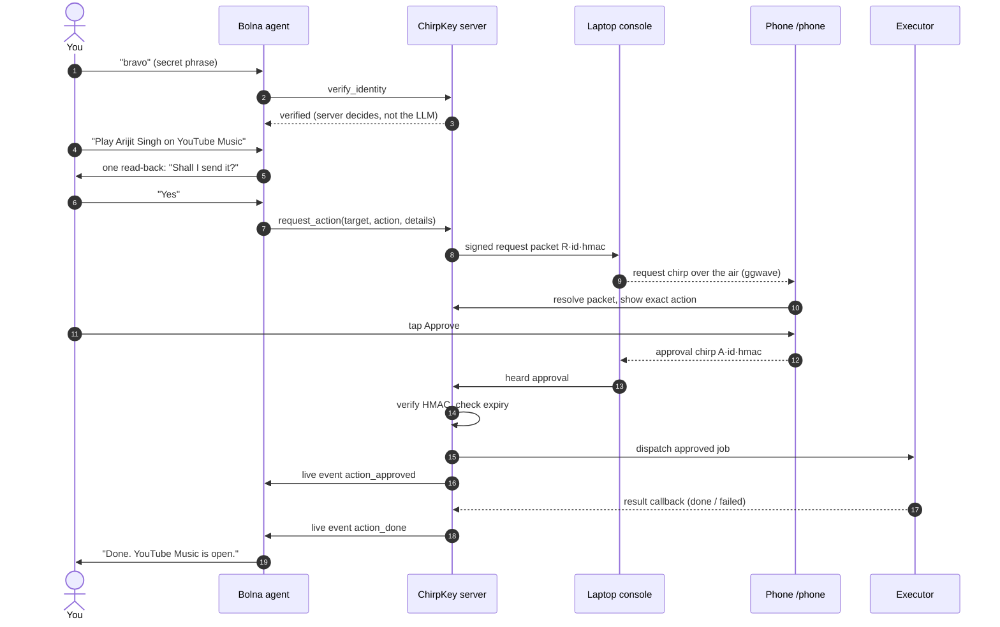
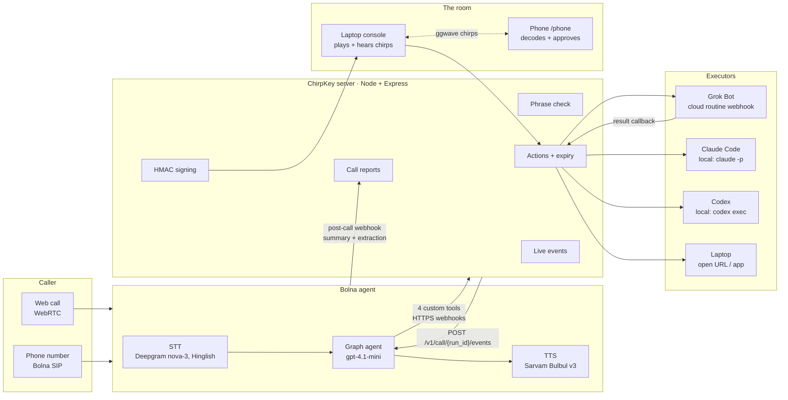
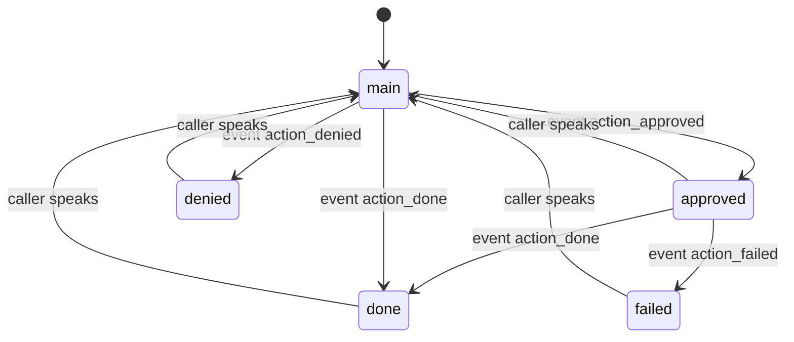
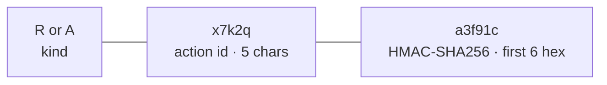

# ChirpKey

**A voice agent for your AI stack, where nothing runs until your phone approves it over sound.**

Call ChirpKey and ask for anything: cancel a subscription, run a Grok bot, have Claude Code or Codex fix a bug, open YouTube Music on your laptop. The agent turns your request into a signed action. Your laptop plays it as a short [ggwave](https://github.com/ggerganov/ggwave) chirp, and your phone decodes it, shows exactly what will run and chirps a signed approval back. Only then does anything run.

Built at the **Bolna × Wispr Flow "Build Out Loud" hackathon** (Bengaluru, Nov 2026) on [Bolna](https://bolna.ai) voice agents, built by voice with Wispr Flow.

---

## Why I built this

Voice agents are getting tools that **spend money and touch code**. "Cancel my subscription" or "push this fix" shouldn't run just because something on a call *sounded* like you.

Today, these calls are **human-to-agent**. Soon they'll be **agent-to-agent**: your assistant calls a vendor's agent, a booking agent calls a payments agent. When the caller is another agent, there is no voice to recognise at all. Approvals need something both sides can verify: **signed data, not vibes.**

Sound is the one channel every voice agent already shares. Two agents on a call don't need to keep talking in English. They can switch to data-over-sound and exchange signed packets directly, without a speech-to-text and LLM round trip on every turn.

ChirpKey is a working example of that idea, at human-to-agent scale.

## Why the demo uses a web call

The idea of agents switching from speech to sound isn't new. What's missing is the **infrastructure** for it.

Real phone calls run through SIP trunks that compress audio to narrowband codecs (G.711, roughly 300–3400 Hz). That squeezes and distorts data-over-sound signals: in my simulations, ordinary audible chirps did not survive a phone-line codec. Running real agent-to-agent calls would need my own telephony stack: a SIP trunk, a media server and control over the audio path and codecs. I haven't built that yet.

So the demo uses a **Bolna web call** (WebRTC). The audio stays clean, and you can actually **hear the chirp** happen. The same agent is also linked to a real US phone number. On a phone call you can switch to **voice approval mode**, or keep chirp approval between the laptop and the phone in the room.

> This is a glimpse of what agent-to-agent approval could look like once the telephony infrastructure exists.

---

## How it works



1. **Identity.** The agent asks for the secret phrase and calls `verify_identity`. The server checks it, so the model can't be talked into saying yes.
2. **Request.** The agent reads the request back once and calls `request_action` with a target (`grok_bot`, `claude_code`, `codex`, `laptop`, `gpu`).
3. **Request chirp.** The server signs a 12-character packet. The laptop mutes its call mic and plays the packet as a ggwave chirp.
4. **Approval.** The phone decodes the chirp and shows exactly what will run. Tap **Approve** and it chirps a signed approval back. If the laptop misses it, the phone can approve over the network instead, but only by presenting the request chirp it heard as proof of presence.
5. **Dispatch.** The server verifies the signature and runs the job.
6. **Live events.** The server pushes `action_approved` and `action_done` into the live Bolna call. The graph agent switches node and tells you the result without being asked.
7. **After the call.** Bolna posts a summary and the extracted outcomes to the server's webhook, and they appear under **Call reports**.

---

## Architecture



### What Bolna does

| Bolna feature | How ChirpKey uses it |
|---|---|
| **Web calls** (`@bolna/web-call`) | The server mints short-lived sessions, so the API key never reaches the browser |
| **Phone numbers** | Inbound and outbound calls on a real number, same agent |
| **Custom function tools** | `verify_identity`, `request_action`, `check_action_status`, `set_approval_mode`, each a webhook into the server |
| **Graph agent** | Nodes for `main`, `approved`, `done`, `failed`, `denied`, with event edges between them |
| **Live events API** | The server pushes status into the running call so the agent speaks first |
| **Multilingual stack** | Deepgram nova-3 (code-switched Hindi + English) and Sarvam Bulbul v3, for natural Hinglish |
| **Call summary + extractions** | Post-call summary plus a "ChirpKey Outcomes" category: requests, target, outcome, language |
| **Execution webhooks** | Call status and reports flow back to the server |

### Live events in the graph agent



Event properties (`action`, `target_name`, `result_summary`) are merged into the call context and used inside node prompts. Events are serialized on the server so `done` never arrives before `approved`.

---

## The chirp

ChirpKey uses **[ggwave](https://github.com/ggerganov/ggwave)**, a small data-over-sound library. Bytes are encoded as frequency-shift-keyed tones: each symbol is a set of tones, sent over a few hundred milliseconds. The receiving device's microphone decodes them back into bytes.

Each packet is **12 characters**:



| Packet | Meaning | Who sends it |
|---|---|---|
| `R` + id + hmac | Request: "this action wants approval" | Laptop |
| `A` + id + hmac | Approval of that exact action | Phone |

The HMAC key lives only on the server. A replayed, edited or invented chirp fails verification, and unapproved requests expire after 10 minutes.

**Implementation notes**

- The audio context is pinned to **48 kHz**. At 44.1 kHz, decoding failed.
- Three protocols are available: `AUDIBLE_FAST` (default, so you can hear it), `DT_FASTEST` (dual-tone, the most robust over narrowband) and `ULTRASOUND_FASTEST` (near-silent, on browsers and speakers that support it).
- The console mutes its own side of the call while chirping, so the agent doesn't try to transcribe the tones.

---

## Trust model

| Decision | Who decides | Why |
|---|---|---|
| Is this the owner? | Server phrase check | An LLM can be persuaded; a string compare can't |
| Can this action run? | HMAC on the chirp + your tap | Forged or replayed packets fail verification |
| Is the approver present? | Sound | Only a device in the room can hear the chirp |
| What can Codex touch? | Codex sandbox (`workspace-write`) | It can only write inside the project folder |
| What can "laptop" do? | Server | Opens URLs or apps with macOS `open`; no shell |

### Approval modes

| Mode | Approval | Use it when |
|---|---|---|
| **Chirp** (default) | Signed chirp to the phone and a tap on Approve | Web calls; anything that spends money or changes code |
| **Voice** | Your spoken "yes" after the read-back | Calling from your own phone, away from the laptop |

Switch mid-call: *"switch to voice mode"* or *"switch to chirp mode"*.

---

## Run it

**Requirements:** Node 22+, a Bolna account, and an HTTPS tunnel (ngrok, or a deployed host), because Bolna's tools and the phone's microphone both need HTTPS.

```bash
git clone https://github.com/perfect7613/chirpkey.git
cd chirpkey
npm install
cp .env.example .env
ngrok http 3000            # in another terminal; copy the https URL into PUBLIC_URL
```

Fill in `.env` (see `.env.example`). At minimum, set:

- `BOLNA_API_KEY`
- `PUBLIC_URL`
- `TOOLS_TOKEN`
- `CHIRP_SIGNING_SECRET`
- `SECRET_PHRASE`

Then create or update the agents and start the server:

```bash
npm run setup-agent            # classic agent → BOLNA_AGENT_ID
npm run setup-agent -- --graph # graph agent with live events → BOLNA_GRAPH_AGENT_ID
npm start
```

| Where | What to do |
|---|---|
| **Laptop** | Open `PUBLIC_URL` and click anywhere once to enable audio |
| **Phone** | Scan the QR code on the console (HTTPS), tap **Listen** and keep it near the laptop |
| **Call** | Click **Start web call**, say the phrase, ask for something |
| **Phone number** | Enter your number and click **Call my phone**, or call the Bolna number linked to the agent |

Re-run `npm run setup-agent` whenever `PUBLIC_URL` changes. The **Test without a call** card exercises the chirp path between laptop and phone without using Bolna minutes.

## Executors

Leave an executor unconfigured and it is simulated (marked done after 4 seconds).

| Target | Configure with | What happens |
|---|---|---|
| `grok_bot` | `GROK_BOT_WEBHOOK_URL`, `GROK_BOT_WEBHOOK_KEY` | Triggers a Grok Bot routine, which reports back to the callback URL. See [docs/grok-bot-routine.md](docs/grok-bot-routine.md) |
| `claude_code` | `CLAUDE_CODE_WORKDIR` | Runs `claude -p` locally (`acceptEdits`, optional spend cap) |
| `codex` | `CODEX_WORKDIR` | Runs `codex exec` locally in a `workspace-write` sandbox |
| `laptop` | on by default (`LAPTOP_ACTIONS=off` disables it) | Opens a site or app, or searches YouTube Music, YouTube or Spotify |
| `gpu` | `GPU_WEBHOOK_URL`, `GPU_WEBHOOK_KEY` | Your GPU job API |
| custom | `EXTRA_TARGETS=name` and `NAME_WEBHOOK_URL` | n8n, Zapier, deploy hooks, … |

Webhook executors receive the approved request, plus a `callback_url` and `callback_token`. To report back, they POST `{"status":"done","summary":"…"}` to the callback URL.

## Project layout

```
server.js                 tools, chirp signing, actions, live events, webhooks, call reports
lib/executors.js          routes approved actions to webhooks or local runners
lib/local.js              Claude Code, Codex and the laptop opener
lib/phrase.js             forgiving secret-phrase matching for speech recognition
public/                   laptop console, phone approver, shared ggwave code (chirp.js)
scripts/agent-config.mjs  Bolna agent definitions (classic + graph), tools, prompts
scripts/setup-agent.mjs   creates or updates the agents and the extraction categories
docs/grok-bot-routine.md  instructions to paste into a Grok Bot routine
```

## Roadmap

- **Own telephony:** a SIP trunk and media server with control over codecs, so chirps survive real phone calls.
- **Agent-to-agent calls:** two agents call each other, switch from speech to chirps, and approve each other's actions with signed packets.
- **Per-device keys:** replace the shared HMAC secret with a key pair per approver device.
- **Spending policies:** amount limits and allow-lists per executor, enforced by the server.

## Built with

[Bolna](https://bolna.ai) · [ggwave](https://github.com/ggerganov/ggwave) · Deepgram · Sarvam AI · Grok Bot · Claude Code · Codex · Express · Wispr Flow
